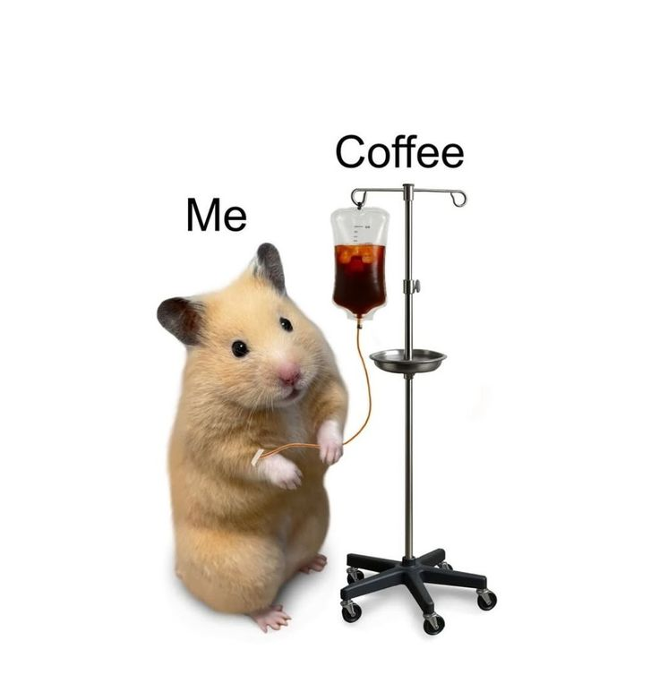

# Introduction
Hi! I'm Syahirah, a student in the Software Maintenance
and Evolution course.
I expect to learn a lot about modern software maintenance
practices and how to work with legacy systems.
- **Fun fact**: I love coffee alot!
- **Course expectations**: I hope to gain practical insight into how real-world engineering teams coordinate
major system updates and legacy migrations without disrupting the end-user experience

